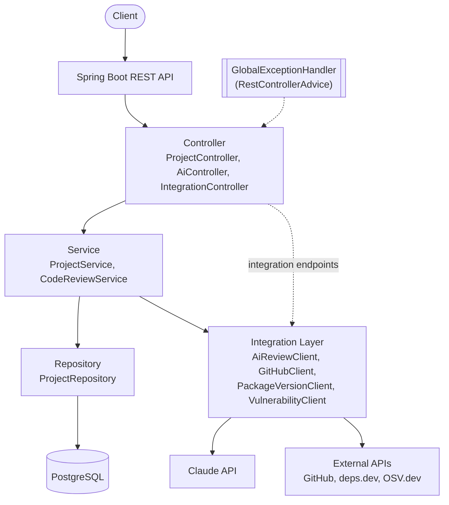
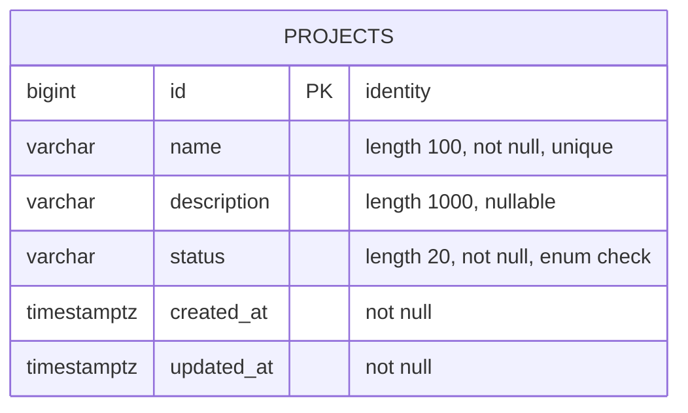
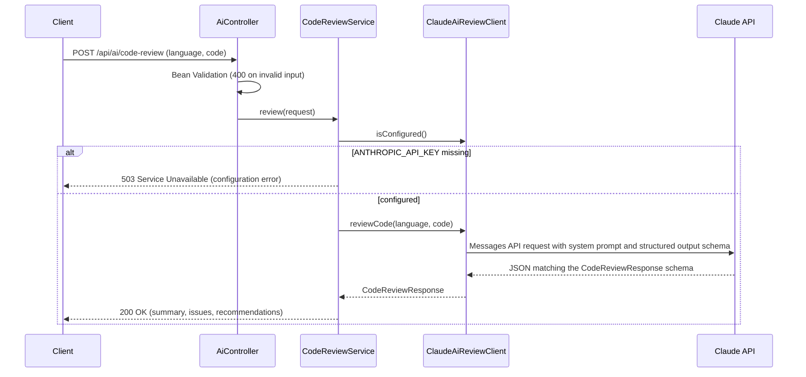

# AI Agent-Powered Backend Service Platform

A Spring Boot backend for managing software projects, with an AI-powered code review endpoint backed by the **Claude API** and a small, extensible integration layer for third-party developer APIs (GitHub, deps.dev, OSV.dev).

The codebase is intentionally compact: a classic layered architecture, clear package boundaries, and tests for every layer. That makes it easy to read end-to-end, and it is structured the way a production service would be.

---

## Table of Contents

- [Project Overview](#project-overview)
- [Features](#features)
- [Tech Stack](#tech-stack)
- [Architecture](#architecture)
- [Database Design](#database-design)
- [API Endpoints](#api-endpoints)
- [Claude API Flow](#claude-api-flow)
- [Third-Party API Integrations](#third-party-api-integrations)
- [Docker Setup](#docker-setup)
- [Environment Variables](#environment-variables)
- [How to Run](#how-to-run)
- [How to Test](#how-to-test)
- [Example API Requests](#example-api-requests)
- [Error Handling](#error-handling)
- [Project Structure](#project-structure)
- [Design Decisions](#design-decisions)

---

## Project Overview

The platform lets users create and manage software projects through a REST API and ask Claude to review code snippets. It also shows how a backend talks to outside services through a clean integration layer.

| Capability | What it does |
|------------|--------------|
| **Project management** | CRUD for projects (`name`, `description`, `status`, timestamps) stored in PostgreSQL |
| **AI code review** | Sends code to the Claude API and returns a structured review: summary, issues and recommendations |
| **External integrations** | Looks up GitHub repository info, the latest version of a package, and known vulnerabilities |

Requests flow through Controller → Service → Repository/Integration layers. Every error comes back in one consistent JSON format, and the whole stack starts with a single `docker compose up --build`.

## Features

- **Project management**: full CRUD REST API for software projects, persisted in PostgreSQL with Spring Data JPA.
  - DTOs (Java records) separate the API contract from the JPA entity.
  - Bean Validation on all request bodies and parameters.
  - Case-insensitive unique project names, optional filtering by status.
  - Schema managed by Flyway migrations.
- **AI code review**: `POST /api/ai/code-review` sends code to Claude and returns a structured review (`summary`, `issues`, `recommendations`).
  - Uses the official Anthropic Java SDK with **structured outputs**, so the response always matches the JSON schema.
  - The application starts and works normally without `ANTHROPIC_API_KEY`. Only the AI endpoint returns a clear `503` configuration error.
- **Third-party integrations**: three live integrations with public, credential-free APIs, built on Spring WebClient behind interfaces.
  - Handles timeouts, upstream error statuses, connection failures and malformed responses.
- **Centralized error handling**: one `@RestControllerAdvice` produces a consistent JSON error body with correct HTTP status codes.
- **Docker**: multi-stage Dockerfile and Docker Compose (app + PostgreSQL with health checks).
- **Tests**: unit, web-slice and full-stack tests. No real Claude or third-party calls are made.
- **OpenAPI docs**: Swagger UI at `/swagger-ui.html`.

## Tech Stack

| Area            | Technology                                          |
|-----------------|-----------------------------------------------------|
| Language        | Java 17                                             |
| Framework       | Spring Boot 3.5 (Web, Data JPA, Validation, WebFlux client, Actuator) |
| Database        | PostgreSQL 16, Flyway migrations                    |
| AI              | Claude API via the official `anthropic-java` SDK    |
| HTTP client     | Spring WebClient (Reactor Netty)                    |
| Build           | Maven                                               |
| Containers      | Docker, Docker Compose                              |
| Testing         | JUnit 5, Mockito, Spring MockMvc, H2, OkHttp MockWebServer |
| API docs        | springdoc-openapi (Swagger UI)                      |

## Architecture

The application follows a layered architecture. Controllers handle HTTP concerns only, services hold business rules, repositories handle persistence, and anything that talks to an outside system sits behind an interface in the integration layer.



**Request flow for project management:**

```
Client → ProjectController → ProjectService → ProjectRepository → PostgreSQL
```

**Request flow for AI and external APIs:**

```
Client → AiController → CodeReviewService → AiReviewClient (ClaudeAiReviewClient) → Claude API
Client → IntegrationController → GitHubClient / PackageVersionClient / VulnerabilityClient → External APIs
```

## Database Design

A single `projects` table, created by the Flyway migration `V1__create_projects_table.sql`. Hibernate runs with `ddl-auto: validate`, so the entity must match the migrated schema. Hibernate never modifies the schema itself.



| Column        | Type                       | Notes                                                        |
|---------------|----------------------------|--------------------------------------------------------------|
| `id`          | `BIGINT` identity          | Primary key                                                  |
| `name`        | `VARCHAR(100)`             | Required, unique (also checked case-insensitively in the service) |
| `description` | `VARCHAR(1000)`            | Optional                                                     |
| `status`      | `VARCHAR(20)`              | `PLANNED`, `ACTIVE`, `ON_HOLD`, `COMPLETED`, `ARCHIVED`; defaults to `PLANNED` |
| `created_at`  | `TIMESTAMP WITH TIME ZONE` | Set on insert (`@PrePersist`)                                |
| `updated_at`  | `TIMESTAMP WITH TIME ZONE` | Set on insert and every update (`@PreUpdate`)                |

An index on `status` supports the `?status=` filter.

## API Endpoints

### Projects

| Method   | Endpoint               | Description                                   | Success |
|----------|------------------------|-----------------------------------------------|---------|
| `POST`   | `/api/projects`        | Create a project                              | `201 Created` + `Location` header |
| `GET`    | `/api/projects`        | List projects, newest first (optional `?status=ACTIVE`) | `200 OK` |
| `GET`    | `/api/projects/{id}`   | Get a project by id                           | `200 OK` |
| `PUT`    | `/api/projects/{id}`   | Update a project                              | `200 OK` |
| `DELETE` | `/api/projects/{id}`   | Delete a project                              | `204 No Content` |

Request body for `POST` and `PUT`:

| Field         | Type   | Rules                                                        |
|---------------|--------|--------------------------------------------------------------|
| `name`        | string | required, max 100 chars, unique (case-insensitive)           |
| `description` | string | optional, max 1000 chars                                     |
| `status`      | enum   | optional; `PLANNED` (default on create), `ACTIVE`, `ON_HOLD`, `COMPLETED`, `ARCHIVED`. Omitting it on `PUT` keeps the current status |

### AI

| Method | Endpoint               | Description                         |
|--------|------------------------|-------------------------------------|
| `POST` | `/api/ai/code-review`  | Review a code snippet with Claude   |

Request: `language` (required, max 50 chars) and `code` (required, max 20,000 chars).

### Integrations

| Method | Endpoint | Description |
|--------|----------|-------------|
| `GET`  | `/api/integrations` | List available integrations |
| `GET`  | `/api/integrations/github/repos/{owner}/{repo}` | Public GitHub repository metadata |
| `GET`  | `/api/integrations/packages/latest?ecosystem=maven&name=com.google.guava:guava` | Latest version of a package (deps.dev) |
| `GET`  | `/api/integrations/vulnerabilities?ecosystem=Maven&name=...&version=...` | Known vulnerabilities for a package version (OSV.dev) |

### Operational

| Endpoint | Description |
|----------|-------------|
| `GET /actuator/health` | Health check (includes database connectivity) |
| `GET /swagger-ui.html` | Interactive OpenAPI documentation |
| `GET /v3/api-docs`     | OpenAPI JSON |

## Claude API Flow



How it works:

1. **`AiReviewClient`** is the provider-agnostic interface the service depends on. **`ClaudeAiReviewClient`** is the implementation.
2. The client uses the official **Anthropic Java SDK**. The request's output format is derived from the `CodeReviewResponse` record, so Claude returns JSON that matches that schema exactly. No regex or free-text parsing is needed.
3. A fixed system prompt sets the reviewer role and tells the model to treat the submitted code as data, not instructions.
4. Failures map to clear errors:
   - API key missing → `503`
   - Claude API error, network failure, refusal, output truncated at `max_tokens`, or unparseable output → `502` with a descriptive message
5. The SDK client is only created when a key is present. It has a configurable timeout and retries transient failures (429/5xx) twice.
6. The model defaults to `claude-opus-5-5` and can be changed with `CLAUDE_MODEL`.

Example response:

```json
{
  "summary": "The method works for the happy path but fails on null input and uses string concatenation in a loop.",
  "issues": [
    {
      "severity": "HIGH",
      "location": "line 3",
      "description": "names can be null, which causes a NullPointerException in the for-each loop.",
      "suggestion": "Guard against null or accept an empty list via Objects.requireNonNullElse."
    },
    {
      "severity": "LOW",
      "location": "line 5",
      "description": "String concatenation inside a loop creates many intermediate strings.",
      "suggestion": "Use String.join(\", \", names) or a StringBuilder."
    }
  ],
  "recommendations": [
    "Add unit tests for null and empty input.",
    "Make the method static since it does not use instance state."
  ]
}
```

## Third-Party API Integrations

All three use free, public APIs that need no credentials.

| Integration | Interface | Implementation | Upstream API | Purpose |
|-------------|-----------|----------------|--------------|---------|
| `github`    | `GitHubClient` | `GitHubApiClient` | `GET https://api.github.com/repos/{owner}/{repo}` | Repository metadata: stars, forks, language, license, last push |
| `deps-dev`  | `PackageVersionClient` | `DepsDevApiClient` | `GET https://api.deps.dev/v3/systems/{system}/packages/{name}` | Latest published version of a Maven/npm/PyPI/Go/Cargo/NuGet package |
| `osv`       | `VulnerabilityClient` | `OsvApiClient` | `POST https://api.osv.dev/v1/query` | Known CVEs/advisories for a specific package version |

Together they answer the dependency questions developers ask about a project: *Is this library maintained? Am I on the latest version? Does my version have known vulnerabilities?*

### Design

- **`ExternalIntegration`**: common interface (`name`, `description`, `baseUrl`). `GET /api/integrations` lists every bean that implements it, so new integrations appear automatically.
- **Domain interfaces** (`GitHubClient`, `PackageVersionClient`, `VulnerabilityClient`): callers depend on these, never on WebClient.
- **`AbstractExternalApiClient`**: shared WebClient plumbing and error mapping.

| Failure | Result |
|---------|--------|
| Connect timeout / response timeout / overall timeout | `504 Gateway Timeout` |
| Upstream `404` | `404 Not Found` with a specific message |
| Other upstream `4xx`/`5xx` | `502 Bad Gateway` |
| Connection failure | `502 Bad Gateway` |
| Invalid JSON, empty body, or missing required fields | `502 Bad Gateway` ("malformed response") |

Upstream payloads are mapped into private records with `@JsonIgnoreProperties(ignoreUnknown = true)`, so new upstream fields don't break deserialization. Required fields are checked explicitly.

**Adding a new integration:** create a domain interface, add a `@Component` that extends `AbstractExternalApiClient` and implements it, add a base URL to `IntegrationProperties`, and expose an endpoint if needed.

## Docker Setup

| File | Purpose |
|------|---------|
| `Dockerfile` | Multi-stage build. A `maven:3.9-eclipse-temurin-17` stage caches dependencies and builds the JAR. The runtime stage uses `eclipse-temurin:17-jre` and runs as a non-root user. |
| `docker-compose.yml` | Starts two services: **`postgres`** (PostgreSQL 16 with a named volume and a `pg_isready` health check) and **`app`** (the Spring Boot service). The app starts only after the database is healthy and has its own health check on `/actuator/health`. |
| `.dockerignore` | Keeps `target/`, `.git/`, IDE folders and `.env` out of the build context. |

Compose reads optional values from `.env` (see [Environment Variables](#environment-variables)). The app connects to the database using the Compose service name: `jdbc:postgresql://postgres:5432/aiplatform`.

Useful commands:

```bash
docker compose up --build          # build and start everything
docker compose up -d postgres      # start only the database
docker compose logs -f app         # follow application logs
docker compose down                # stop containers (keep data)
docker compose down -v             # stop and delete the database volume
```

## Environment Variables

| Variable            | Required | Default                                       | Description |
|---------------------|----------|-----------------------------------------------|-------------|
| `ANTHROPIC_API_KEY` | No       | *(empty)*                                     | Claude API key. Without it, only `/api/ai/code-review` is unavailable (`503`). |
| `CLAUDE_MODEL`      | No       | `claude-opus-5-5`                             | Claude model used for reviews |
| `DB_URL`            | No       | `jdbc:postgresql://localhost:5432/aiplatform` | JDBC URL (set automatically by Docker Compose) |
| `DB_USERNAME`       | No       | `aiplatform`                                  | Database user |
| `DB_PASSWORD`       | No       | `aiplatform`                                  | Database password |
| `SERVER_PORT`       | No       | `8080`                                        | HTTP port |
| `POSTGRES_DB` / `POSTGRES_USER` / `POSTGRES_PASSWORD` | No | `aiplatform` | Used by Docker Compose for the PostgreSQL container and passed to the app |
| `APP_PORT` / `POSTGRES_PORT` | No | `8080` / `5432` | Host ports published by Docker Compose |

Copy `.env.example` to `.env` to set these values. `.env` is git-ignored. **Never commit API keys or passwords.** The defaults are for local development only.

## How to Run

### Option 1: Docker Compose (recommended)

Prerequisites: Docker with Compose v2.

```bash
git clone https://github.com/<your-username>/ai-agent-powered-backend-service-platform.git
cd ai-agent-powered-backend-service-platform

cp .env.example .env          # optional: add ANTHROPIC_API_KEY, change the DB password
docker compose up --build
```

This starts PostgreSQL 16 and the application. The app waits for the database health check, and Flyway creates the schema on startup.

- API: http://localhost:8080/api/projects
- Swagger UI: http://localhost:8080/swagger-ui.html
- Health: http://localhost:8080/actuator/health

Stop with `docker compose down`. Add `-v` to also delete the database volume.

### Option 2: Run locally with Maven

Prerequisites: Java 17+, Maven 3.9+, and a PostgreSQL instance.

```bash
# Start only the database from Compose (or use your own PostgreSQL)
docker compose up -d postgres

# Optional: enable the AI endpoint
export ANTHROPIC_API_KEY=your-key-here
# Only needed if you changed POSTGRES_PASSWORD in .env
# export DB_PASSWORD=your-db-password

mvn spring-boot:run
```

## How to Test

```bash
mvn test
```

The test suite needs no database, Docker, network access, or API keys:

| Test class | Type | Covers |
|------------|------|--------|
| `ProjectServiceTest` | Unit (Mockito) | Business rules: defaults, trimming, duplicate names, not-found, update/delete |
| `ProjectControllerTest` | Web slice (`@WebMvcTest`) | Status codes, `Location` header, validation errors, malformed JSON, type mismatches, 404/409/500 handling |
| `ProjectApiIntegrationTest` | Full stack (`@SpringBootTest`, H2) | End-to-end CRUD through Flyway schema; app starts without an API key; AI endpoint returns 503 |
| `CodeReviewServiceTest` | Unit, mocked `AiReviewClient` | Successful review, missing configuration, empty/failed provider responses |
| `AiControllerTest` | Web slice, mocked `AiReviewClient` | Structured JSON response, validation, 503 and 502 mapping |
| `ClaudeAiReviewClientTest` | Unit | Clear configuration error when no key is set (no network call) |
| `ExternalApiClientsTest` | MockWebServer | Response mapping, URL encoding, upstream 404/500, malformed JSON, missing fields, timeouts |

**Tests never call the real Claude API.** The AI client is mocked, and the test configuration sets an empty API key.

## Example API Requests

**Create a project**

```bash
curl -i -X POST http://localhost:8080/api/projects \
  -H "Content-Type: application/json" \
  -d '{"name": "Payments API", "description": "Billing and invoicing service", "status": "ACTIVE"}'
```

```http
HTTP/1.1 201 Created
Location: http://localhost:8080/api/projects/1

{"id":1,"name":"Payments API","description":"Billing and invoicing service","status":"ACTIVE",
 "createdAt":"2026-10-04T04:13:48.176328Z","updatedAt":"2026-10-04T04:13:48.176328Z"}
```

**List, filter and fetch**

```bash
curl http://localhost:8080/api/projects
curl "http://localhost:8080/api/projects?status=ACTIVE"
curl http://localhost:8080/api/projects/1
```

**Update**

```bash
curl -X PUT http://localhost:8080/api/projects/1 \
  -H "Content-Type: application/json" \
  -d '{"name": "Payments API", "description": "Billing, invoicing and refunds", "status": "COMPLETED"}'
```

**Delete**

```bash
curl -i -X DELETE http://localhost:8080/api/projects/1     # 204 No Content
```

**AI code review**

```bash
curl -X POST http://localhost:8080/api/ai/code-review \
  -H "Content-Type: application/json" \
  -d '{
    "language": "java",
    "code": "public String join(List<String> names) {\n  String result = \"\";\n  for (String n : names) {\n    result += n + \", \";\n  }\n  return result;\n}"
  }'
```

**Integrations**

```bash
curl http://localhost:8080/api/integrations
curl http://localhost:8080/api/integrations/github/repos/spring-projects/spring-boot
curl "http://localhost:8080/api/integrations/packages/latest?ecosystem=maven&name=com.google.guava:guava"
curl "http://localhost:8080/api/integrations/vulnerabilities?ecosystem=Maven&name=com.fasterxml.jackson.core:jackson-databind&version=2.9.10"
```

## Error Handling

Every error uses the same JSON shape, produced by `GlobalExceptionHandler`:

```json
{
  "timestamp": "2026-10-04T04:13:48.428Z",
  "status": 400,
  "error": "Bad Request",
  "message": "Request validation failed",
  "path": "/api/projects",
  "fieldErrors": { "name": "name is required" }
}
```

| Situation | Status |
|-----------|--------|
| Bean Validation failure, malformed JSON, invalid enum, wrong parameter type | `400` |
| Project / endpoint / upstream resource not found | `404` |
| Unsupported HTTP method | `405` |
| Duplicate project name | `409` |
| Unexpected server error (no internals leaked) | `500` |
| Claude or third-party API failure, malformed upstream response | `502` |
| AI endpoint called without `ANTHROPIC_API_KEY` | `503` |
| Third-party API timeout | `504` |

## Project Structure

```
ai-agent-powered-backend-service-platform/
├── Dockerfile                      # Multi-stage build (Maven → JRE 17), runs as non-root
├── docker-compose.yml              # App + PostgreSQL with health checks
├── pom.xml
├── .env.example                    # Template for local environment variables
├── src/main/java/com/aiplatform/
│   ├── PlatformApplication.java
│   ├── project/                    # Project management feature
│   │   ├── controller/ProjectController.java
│   │   ├── service/ProjectService.java
│   │   ├── repository/ProjectRepository.java
│   │   ├── model/Project.java, ProjectStatus.java
│   │   └── dto/ProjectRequest.java, ProjectResponse.java
│   ├── ai/                         # AI code review feature
│   │   ├── controller/AiController.java
│   │   ├── service/CodeReviewService.java
│   │   ├── client/AiReviewClient.java, ClaudeAiReviewClient.java
│   │   └── dto/CodeReviewRequest.java, CodeReviewResponse.java, ReviewIssue.java, IssueSeverity.java
│   ├── integration/                # Third-party API integration layer
│   │   ├── core/ExternalIntegration.java, AbstractExternalApiClient.java,
│   │   │        IntegrationProperties.java, WebClientConfig.java
│   │   ├── github/GitHubClient.java, GitHubApiClient.java, GitHubRepositoryInfo.java
│   │   ├── depsdev/PackageVersionClient.java, DepsDevApiClient.java, LatestPackageVersion.java
│   │   ├── osv/VulnerabilityClient.java, OsvApiClient.java, VulnerabilityReport.java
│   │   └── controller/IntegrationController.java, IntegrationInfo.java
│   ├── config/ClaudeProperties.java
│   └── common/
│       ├── exception/              # Domain exceptions
│       └── web/GlobalExceptionHandler.java, ErrorResponse.java
├── src/main/resources/
│   ├── application.yml
│   └── db/migration/V1__create_projects_table.sql
└── src/test/
    ├── java/com/aiplatform/{project,ai,integration}/   # Tests
    └── resources/application.yml                       # H2 + empty API key
```

The code is organized **by feature** (`project`, `ai`, `integration`), with layers inside each feature. Everything related to one capability lives in one place.

## Design Decisions

- **Layered architecture (Controller → Service → Repository).** Each layer has one responsibility, and each can be tested in isolation: services with Mockito, controllers with `@WebMvcTest`, the whole stack with `@SpringBootTest`.
- **DTOs as Java records.** The JPA entity is never exposed over HTTP, so the database model and the API contract can change independently. Records keep DTOs immutable and concise.
- **Flyway instead of `ddl-auto: update`.** The schema is versioned, reviewable SQL. Hibernate only *validates* that the entity matches, which catches drift at startup.
- **Database constraints back up service checks.** The service gives friendly duplicate-name errors, and the unique constraint and `CHECK` on `status` guarantee integrity even under concurrent requests. Constraint violations are still returned as `409`.
- **`AiReviewClient` interface.** The service depends on an abstraction, so the AI provider can be swapped or mocked. Tests never touch the network.
- **Structured outputs for Claude.** The response schema is derived from `CodeReviewResponse`, so the API returns typed, schema-valid JSON without parsing free text.
- **Optional AI configuration.** A missing `ANTHROPIC_API_KEY` disables only the AI endpoint, with a `503` that says how to fix it. The rest of the platform keeps working, so a missing secret never causes a startup failure.
- **WebClient with layered timeouts.** Connect timeout, response timeout and an overall `Mono.timeout` keep a slow upstream from tying up request threads. Every failure mode becomes a typed `ExternalApiException` with an appropriate status.
- **Centralized exception handling.** One `@RestControllerAdvice` gives every endpoint the same error format and keeps `try/catch` out of controllers. Unexpected errors are logged server-side and never leak stack traces.
- **Secrets only through the environment.** No keys or passwords are hardcoded. `.env` is git-ignored, and `.env.example` documents what to set.
- **Container best practices.** Multi-stage build with a dependency-cache layer, a slim JRE runtime image, a non-root user, and health-checked startup ordering in Compose.
